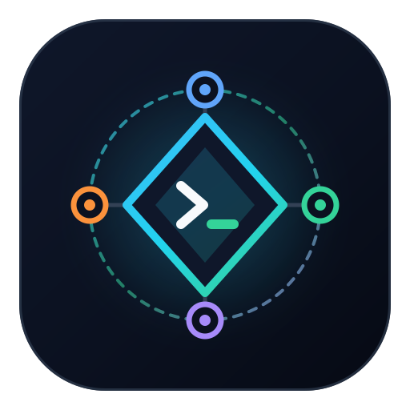

<div align="center">



# All-in-One (`aio`)

**面向多 CLI Coding Agent 的统一终端编排工作台**

[](https://github.com/loucongV/all-in-one/actions/workflows/ci.yml)
[](https://go.dev/)
[](LICENSE)
[-38BDF8?style=flat-square)](#快速安装与构建)

简体中文 · [English](README_EN.md) · [详细使用指南](docs/USAGE.md) · [路线图](docs/ROADMAP.md) · [架构设计](docs/DESIGN.md)

</div>

---

`aio` 是一个单二进制、零外部依赖的 Go 终端工作台（后台常驻 Daemon + Bubble Tea TUI + 局域网手机 Web 桥接），把 **Claude Code、Codex CLI、Antigravity (`agy`)、Cursor CLI、Kimi Code、OpenCode** 以及 **Magpie 模型路由网关** 统一纳管到一个高效的多项目工作空间中。

## 核心特性

- **统一入口 & 后台常驻保活**：内置后台 Daemon（`~/.aio/daemon.sock`），退出 TUI 或断开 SSH 连接不会中断任何正在执行的 Agent；重开 `aio` 瞬间无损接回实时终端输出与 10,000 行滚动历史。
- **多项目并行监控 & 原生状态感知**：结合各 CLI 原生生命周期 Hooks / OSC 标题 / 屏幕兜底状态机，实时区分 `运行中`、`待确认`、`完成`、`停止`，跨项目高亮等待人工确认的任务，按 `w` 一键直达。
- **Git Worktree 单仓 & 多仓隔离**：
  - 支持 **本地直连**、**共享 Worktree 接力**（同一分支下无缝切换不同 Agent 接力协作）、**独立 Worktree 并行对比（Compare Mode）**；
  - 自动识别嵌套多仓工作区（Multi-Repo），生成复合 Worktree 并自动软链顶层共享文档（如 `CLAUDE.md`、`docs/`），支持 `.aio.toml` 自动拷贝 `.env` / 执行初始化命令；
  - 内置横向 Diff 对比面板，按 GitHub 风格（`Squash` / `Merge` / `Rebase`）一键采纳胜出分支并自动清理其余临时 Worktree 与分支。
- **精准 Session 绑定与续聊**：自动捕获每个 Agent 的底层会话 ID，支持按 `r` 扫描本地历史 Session 列表、绑定、续接、新建或删除清理。
- **一站式控制中心（`,`）**：
  - **CLI 工具管理**：自动探测本机路径（含 `nvm`/`fnm`/`mise`/`~/.local/bin`）、自定义路径、一键后台交互安装（带代理失败自动直连重试与日志保留）；
  - **Magpie 模型路由网关**：内置集成 [Magpie](https://usemagpie.ai/) TUI 与按任务模型路由；
  - **按 Agent 分流代理**：支持自动跟随环境 / 手动指定 / 强制直连，并可按 Agent 配置直连白名单（如 Kimi 直连、Claude/Codex 走代理）；
  - **实时多池额度监控**：实时展示当前活跃 Agent 的剩余额度与重置倒计时（如 `agy` 的 Gemini `G:` / Claude `C:` 独立双池、Codex/Cursor `/usage` 静默探测）。
- **局域网手机扫码远程控制**：内置零 CDN 移动端 Web App，支持 HTTP/HTTPS（自签 TLS）一键切换、手机语音输入、800 行完整历史原生滑动、按设备独立签发与踢出 Session 管理，以及 Android 全屏 / iPhone 主屏幕独立全屏。
- **全终端 & SSH / `tmux` 深度适配**：内置 256 色自适应与 PTY 色彩下采样、`vtStreamCompat` 宽字符换行与 `CSI u` 兼容修复、无热键冲突的 `TERM` 模式（缓冲式双击 `Esc` 防误断 + `Ctrl+]` 退导航 + `Ctrl+\` 对话中直呼工作区 Shell）。

---

## 支持的 Agent CLI

| Agent | 命令 | 实时状态跟踪方式 | 历史 Session 绑定 | 额度监控 |
| :--- | :--- | :--- | :---: | :---: |
| **Claude Code** | `claude` | 原生 Hooks（`UserPromptSubmit` / `PreToolUse` / `Notification` / `Stop`） | ✅ | ✅ |
| **Codex CLI** | `codex` | `notify` 钩子 + OSC 9 + `Worked for` 屏幕状态兜底 | ✅ | ✅ |
| **Antigravity** | `agy` | 原生 `--agy-state` 实时状态钩子 | ✅ | ✅（G/C 双池） |
| **Cursor CLI** | `cursor-agent` | 原生 OSC 窗口标题状态解析 | ✅ | ✅（`/usage`） |
| **Kimi Code** | `kimi` | PTY 输入跟踪 + 退出/通知事件 | ✅ | ✅ |
| **OpenCode** | `opencode` | PTY 输入跟踪 + 退出/通知事件 | ✅ | ✅ |
| **Magpie（路由网关）** | `magpie` | 控制中心一键安装与嵌入式 TUI 面板 | — | — |

---

## 快速安装与构建

### 方式一：下载预编译静态二进制

从 [GitHub Releases](https://github.com/loucongV/all-in-one/releases) 下载对应平台的直接可执行静态包（无 CGO 依赖，开箱即用）：

- `aio-<version>-linux-amd64` / `aio-<version>-linux-arm64`
- `aio-<version>-darwin-amd64` / `aio-<version>-darwin-arm64`

```bash
chmod +x aio-v0.1.0-linux-amd64
mv aio-v0.1.0-linux-amd64 ~/.local/bin/aio
aio version
```

### 方式二：通过 `go install` 或源码构建（需要 Go 1.26+）

```bash
# 直接安装最新版
go install github.com/loucongV/all-in-one/cmd/aio@latest

# 或源码构建（自动注入 VERSION、Commit 与构建时间）
git clone https://github.com/loucongV/all-in-one.git
cd all-in-one
make build

# 可选：安装到 ~/.local/bin
cp ./aio ~/.local/bin/aio

# 打包全平台直接静态二进制（输出到 dist/ 并生成 SHA256SUMS）
make dist
```

---

## 30 秒上手

```bash
# 1. 查看版本与本机检测到的 Agent CLI
aio version
aio agents

# 2. 启动交互式工作台（首次启动自动在后台拉起 aio daemon）
aio
```

进入界面后：
1. 按 **`p`** 选择或新建一个本地工作目录（自动识别 Git 仓库 / 多仓目录 / 普通目录）；
2. 按 **`n`** 新建任务，勾选 1 个 Agent 启动单任务，或勾选多个 Agent 自动进入 **Worktree 对比赛跑**；
3. 按 **`Enter`** 进入右侧实时终端与 Agent 对话；对话中按 **`Ctrl+\`** 随时呼出/切回工作区独立 Shell，按 **双击 `Esc`** 或 **`Ctrl+]`** 回到左侧导航；
4. 按 **`,`** 打开统一控制中心（一键安装 CLI、配置代理、开启手机扫码同步、查看实时额度），按 **`?`** 打开快捷键速查与可执行命令面板。

---

## 常用快捷键速查

### 导航模式（NAV）

| 按键 | 功能 |
| :--- | :--- |
| `↑/↓` (`j/k`) · `←/→` (`h/l`) | 上下移动 · 折叠或展开项目 / 任务节点 |
| `Enter` | 进入右侧终端（已停止会话自动续接）/ 展开折叠节点 |
| `1` ~ `9` | 快速切换到当前任务下的第 1~9 个 Agent |
| `t` / `Ctrl+\` | 在 Agent 视图与工作区独立持久化 Shell 终端之间切换 |
| `w` | 一键跳转至下一个 `待确认`（`waiting_input`）的 Agent |
| `PgUp` / `PgDn` / `End` | 回看终端历史 / 回到底部 |
| `p` | 浏览并添加本地工作目录（支持 `N` 新建目录） |
| `n` / `+` | 新建任务 / 向当前任务追加新 Agent（支持共享 Worktree 接力） |
| `r` | 管理、绑定、切换或新建当前 Agent 的历史 Session |
| `d` / `a` | 横向查看代码 Diff 对比 / 一键采纳胜出分支并清理其余 Worktree |
| `e` / `F2` | 重命名当前选中的任务（不中断运行中的会话） |
| `s` / `x` (`Del`) | 停止当前会话 / 删除并清理进程树（可选同步清理本地历史 Session） |
| **`,`** | 打开 **控制中心**（CLI 工具 / Magpie / 网络代理 / 手机扫码 / 实时额度 / SSH 原生鼠标） |
| **`?`** | 打开 **分组快捷键速查与可执行命令面板** |
| `z` / `y` / `q` | 全屏聚焦 / 复制当前屏幕 / 退出界面（后台 Daemon 与任务保持运行） |

### 终端交互模式（TERM）

| 按键 | 功能 |
| :--- | :--- |
| **双击 `Esc` / `Ctrl+]`** | 220ms 内双击 `Esc`（缓冲防误断，不中断 Agent 回答）或按 `Ctrl+]` 退回导航；单按 `Esc` 正常透传给 Agent |
| **`Ctrl+\`** | 在与 Agent 对话中直接呼出 / 切回工作区独立 Shell 终端（无需先退导航） |
| `F12` | 紧急切换 SSH 原生鼠标 / 右键粘贴模式 |
| 鼠标滚轮 / 拖选 | 直接回看历史 / 拖选自动复制（点击左侧栏直接切回导航） |
| 其余所有按键 | 100% 原样透传给当前 Agent（macOS Option / Linux / SSH / tmux 零冲突） |

---

## CLI 子命令

```bash
aio                    # 启动交互式 TUI（自动拉起后台 daemon）
aio --no-mouse         # 以原生终端鼠标模式启动（便于 SSH 直接右键粘贴）
aio version            # 输出客户端与运行中 daemon 的版本信息（-v / --version）
aio agents             # 列出本机检测到的 Agent CLI 及路径
aio status             # 查看当前项目、任务、会话状态与实时额度摘要
aio quota [--probe]    # 查看（或立即静默探测）各 Agent 额度
aio stop-daemon [-f]   # 优雅停止后台 daemon（存在活跃任务时会列出并二次确认）
```

---

## 文档与配置

- 📖 **[完整使用指南（docs/USAGE.md）](docs/USAGE.md)**：涵盖多仓 Worktree 对比采纳、`.aio.toml` 与 `~/.aio/config.toml` 全量配置、局域网手机扫码与 iPhone/Android 全屏指南、服务端语音转写配置、SSH / MobaXterm / `tmux` 最佳实践与常见问题排查。
- 🏗️ **[系统架构设计（docs/DESIGN.md）](docs/DESIGN.md)**：Daemon / PTY 仿真 / WebSocket 协议 / Worktree 引擎与 TUI 状态机设计说明。
- 🤝 **[贡献指南（CONTRIBUTING.md）](CONTRIBUTING.md)**：本地开发环境、测试规范与 Pull Request 流程。

---

## Roadmap

完整规划见 [docs/ROADMAP.md](docs/ROADMAP.md)：

- **v0.1.0（已发布 Pre-release）**：多 Agent 后台保活编排、单/多仓 Git Worktree 对比采纳、多源实时状态与多池额度、控制中心、局域网手机扫码同步、SSH/`tmux`/MobaXterm 适配。
- **v0.2.0（规划中）**：
  - [ ] UI 多主题（暗/浅/高对比）、SSH 宽字符适配与 `aio doctor` 诊断
  - [ ] Magpie 可视化配置向导（Provider 模板、测通、模型下拉选择）
  - [ ] Skill & MCP 统一管理（跨 Agent 软链/配置同步 + Context Token 估算）
  - [ ] 内置类 iTerm2 多窗格自由分屏（Agent + Shell / 多 Shell / 双 Agent 同屏）
  - [ ] 类 IDEA 代码变更审阅（文件树 + 左右双栏 Diff + 评审意见回发 Agent + 本地 Web Diff）
  - [ ] 公共资料库管理（`--add-dir` / `.git/info/exclude` 零污染只读挂载）
  - [ ] 跨 Agent 接力摘要（Handoff）、消耗统计面板与跨机器 SSH 远程 Daemon
- **v0.3.0+（Backlog）**：数据库连接联动（`lazysql` / 只读 DB MCP）、飞书/钉钉 Webhook 通知、自动验收门禁（Verify Gate）。

---

## License

本项目基于 [MIT License](LICENSE) 开源。
