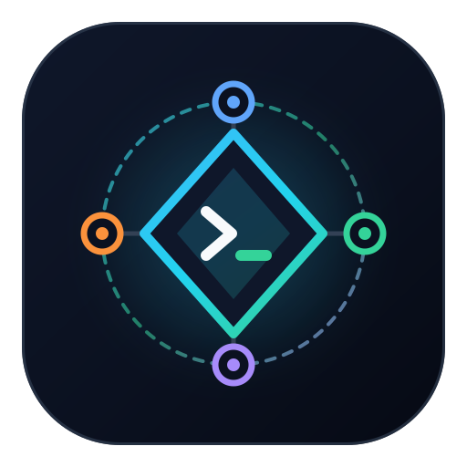

<div align="center">



# All-in-One (`aio`)

**Unified Terminal Orchestrator for Multi-CLI Coding Agents**

[](https://github.com/loucongV/all-in-one/actions/workflows/ci.yml)
[](https://go.dev/)
[](LICENSE)
[-38BDF8?style=flat-square)](#installation--build)

[简体中文](README.md) · English · [Usage Guide (ZH)](docs/USAGE.md) · [Architecture (ZH)](docs/DESIGN.md)

</div>

---

`aio` is a single-binary, zero-dependency Go terminal workspace (persistent Background Daemon + Bubble Tea TUI + LAN Mobile Web Bridge) that orchestrates **Claude Code, Codex CLI, Antigravity (`agy`), Cursor CLI, Kimi Code, OpenCode**, and **Magpie** side by side across multiple projects.

## Key Features

- **Persistent Background Daemon**: Detach from the TUI or drop your SSH connection without killing any running agent. Reopen `aio` anytime to reattach instantly with a 10,000-line VT scrollback buffer.
- **Multi-Project Live Status Tracking**: Combines native agent hooks, OSC window titles, and screen-state fallbacks to accurately distinguish `running`, `waiting_input`, `done`, and `stopped` runs. Press `w` to jump straight to any run waiting for approval.
- **Single-Repo & Multi-Repo Git Worktree Isolation**:
  - Run in local directory mode, **shared worktree handoff** (switch agents on the same branch), or **isolated compare mode** (race multiple agents on the same prompt);
  - Automatically detects multi-repo workspaces, builds composite worktrees with symlinked shared docs (`CLAUDE.md`, `docs/`), and supports `.aio.toml` copy/symlink/setup hooks;
  - Built-in side-by-side Diff viewer with GitHub-style adoption (`Squash` / `Merge` / `Rebase`) and automatic cleanup of losing worktrees & temporary branches.
- **Exact Session Binding & Resume**: Automatically captures CLI session IDs so dormant runs resume seamlessly via `Enter`, with a session manager modal (`r`) to browse, bind, switch, or start fresh sessions.
- **Unified Control Center (`,`)**:
  - **CLI Tool Manager**: Automatic binary discovery (including `nvm`/`fnm`/`mise`/`~/.local/bin`), custom path overrides, and interactive background installers;
  - **Magpie Routing Gateway**: Built-in TUI launch & per-task model routing;
  - **Per-Agent Network Proxy**: Auto / Manual / Direct modes plus per-agent direct-bypass allowlist;
  - **Real-Time Multi-Pool Quota Monitor**: Live remaining quota and reset countdowns across active agents.
- **LAN Mobile QR Sync**: Embedded zero-CDN mobile web app with HTTP/HTTPS (self-signed TLS) toggle, voice input, 800-line native history scrolling, per-device session management (list & revoke individual phones), and fullscreen/PWA home-screen support.
- **SSH, MobaXterm & `tmux` Ready**: Automatic 256-color profile adaptation & PTY color downsampling, CJK right-margin wrap & `CSI u` VT compatibility fixes, and conflict-free `TERM` keymaps (buffered double-`Esc` without interrupting active generation, `Ctrl+]` to NAV, `Ctrl+\` to toggle workspace Shell directly).

---

## Installation & Build

### Option 1: Prebuilt Static Binaries

Download the standalone static binary for your OS/architecture from [GitHub Releases](https://github.com/loucongV/all-in-one/releases):

```bash
chmod +x aio-v0.1.0-linux-amd64
mv aio-v0.1.0-linux-amd64 ~/.local/bin/aio
aio version
```

### Option 2: `go install` or Build from Source (Go 1.26+)

```bash
# Install directly via Go
go install github.com/loucongV/all-in-one/cmd/aio@latest

# Or clone and build with embedded version metadata
git clone https://github.com/loucongV/all-in-one.git
cd all-in-one
make build

# Build all cross-platform static binaries into dist/ with SHA256SUMS
make dist
```

---

## Quick Start

```bash
aio version            # Check client & daemon versions
aio agents             # Inspect detected Agent CLIs
aio                    # Launch interactive TUI (auto-starts background daemon)
```

Inside `aio`:
1. Press **`p`** to add or create a local workspace directory;
2. Press **`n`** to create a task (select 1 agent for single mode, or multiple agents for parallel compare mode);
3. Press **`Enter`** to interact with the agent terminal; use **`Ctrl+\`** to toggle the workspace shell directly from inside a conversation, and **double-`Esc`** or **`Ctrl+]`** to return to navigation;
4. Press **`,`** to open the Control Center, or **`?`** to open the searchable shortcut & command palette.

---

## Essential Shortcuts

| Mode | Shortcut | Action |
| :--- | :--- | :--- |
| **NAV** | `↑/↓` · `←/→` · `Enter` | Navigate tree · collapse/expand · enter terminal (auto-resumes dormant runs) |
| **NAV** | `1`~`9` · `w` | Quick-switch runs in current task · jump to next `waiting_input` run |
| **NAV** | `p` · `n` · `+` | Add directory · new task · add agent to current task |
| **NAV** | `r` · `d` · `a` | Manage/bind sessions · view Diff · adopt winner branch & clean up |
| **NAV** | `t` · `s` · `x` | Toggle workspace shell · stop run · delete & clean process tree/session |
| **NAV** | `,` · `?` · `z` · `q` | Control Center · Help & command palette · fullscreen · quit TUI (keeps daemon running) |
| **TERM** | `Esc × 2` / `Ctrl+]` | Return to NAV (buffered 220ms double-`Esc` never interrupts an active response) |
| **TERM** | `Ctrl+\` | Toggle workspace Shell directly while talking to an agent |
| **TERM** | `F12` | Toggle SSH native mouse / right-click paste mode |

---

## CLI Commands

```bash
aio                    # Launch interactive TUI
aio --no-mouse         # Launch TUI with native terminal mouse (SSH right-click paste)
aio version            # Show client & daemon version info (-v, --version)
aio agents             # List detected local Agent CLIs
aio status             # Print tasks, run statuses, and live quotas
aio quota [--probe]    # Display or live-probe agent quotas
aio stop-daemon [-f]   # Stop background daemon (prompts before interrupting active runs)
```

---

## Contributing & License

Contributions are welcome! Please read [CONTRIBUTING.md](CONTRIBUTING.md) before submitting a pull request.

Licensed under the [MIT License](LICENSE).
