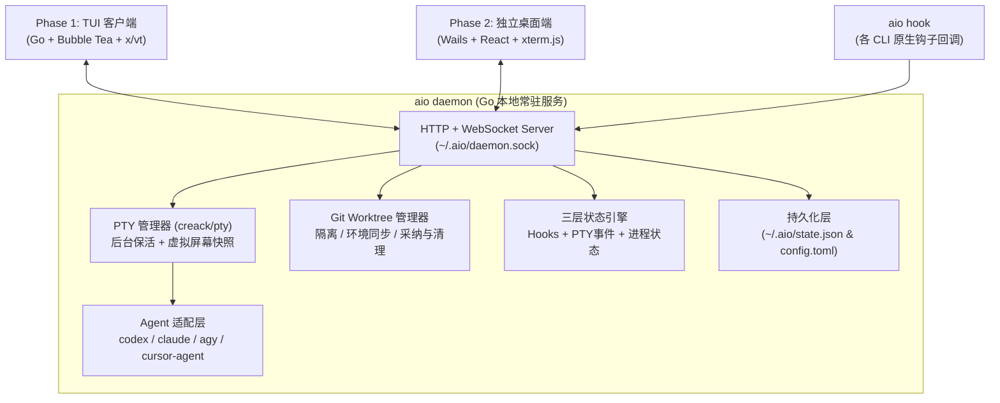

# All-in-One (`aio`) 设计文档

面向 CLI 多 Agent（**Codex / Claude Code / Antigravity / Cursor CLI**）的统一编排工作台。  
核心解决三个高频痛点：**快速启动与秒切、多项目并行状态监控、同仓库 Git Worktree 自动隔离与多 Agent 并行对比（Compare Mode）**。

---

## 1. 总体架构

采用 **Core Daemon + 双端（TUI + Desktop）** 架构：后台常驻 Go Daemon 托管所有真实 PTY 会话与 Git Worktree，前端只负责渲染与交互，关闭前端不中断正在运行的 Agent。



### 技术选型（对齐本机 `Go 1.26` + `Node 22/pnpm`）
- **单二进制分发**：`aio` 同时包含 TUI 客户端、后台 Daemon（`aio daemon`）和轻量钩子命令（`aio hook`）。首次运行 `aio` 自动拉起后台 Daemon。
- **TUI（Phase 1）**：Go + `Bubble Tea` + `Lip Gloss` + `creack/pty` + `charmbracelet/x/vt`（原生虚拟终端模拟，支持在分屏中无损嵌入复杂 CLI TUI）。
- **Desktop（Phase 2）**：`Wails`（Go + React/Vite + `xterm.js`），复用本机已有 Go/Node 工具链，直连同一个 Daemon API。

---

## 2. 目录结构

```text
all-in-one/
├── cmd/
│   └── aio/
│       └── main.go              # 统一入口：aio (TUI) | aio daemon | aio hook
├── internal/
│   ├── protocol/                # Daemon 与客户端共享的请求/事件 DTO
│   ├── store/                   # ~/.aio/config.toml & ~/.aio/state.json 原子读写
│   ├── adapter/                 # 4 大 Agent 适配器接口与实现
│   │   ├── adapter.go
│   │   ├── codex.go
│   │   ├── claude.go
│   │   ├── agy.go
│   │   └── cursor.go
│   ├── worktree/                # Git Worktree 创建、.aio.toml 同步、Diff、Merge/清理
│   ├── ptymgr/                  # PTY 生命周期、RingBuffer、VT 屏幕状态、WS 广播
│   ├── status/                  # 三层状态机（Hook 回调 + PTY 字节流检测 + 进程退出）
│   ├── daemon/                  # Daemon 主控：编排器、UDS HTTP/WS 服务、生命周期
│   └── tui/                     # Bubble Tea 界面：导航树、内嵌 PTY、Compare Diff 面板
├── desktop/                     # Phase 2: Wails 桌面端
├── docs/
│   └── DESIGN.md
├── go.mod
└── go.sum
```

---

## 3. 核心数据模型与配置

### 3.1 三层业务模型
采用 **Project → Task → Run** 三层结构，天然统一「单任务并行」与「多 Agent 对比」：

```go
type Project struct {
    ID            string   // 唯一标识
    Name          string   // 显示名（默认仓库目录名）
    RepoPath      string   // Git 仓库根目录
    DefaultAgents []string // 默认选中的 Agent 列表
}

type Task struct {
    ID          string    // 如 task-20261122-a1b2
    ProjectID   string
    Title       string    // 任务简述
    Mode        string    // "single" | "compare"
    BaseBranch  string    // 创建时的基准分支
    BaseCommit  string    // 创建时的基准 HEAD SHA
    Prompt      string    // 初始自动派发的 Prompt
    WinnerRunID string    // Compare 结束后采纳的 Run ID
    CreatedAt   time.Time
}

type Run struct {
    ID           string    // 如 run-claude-01
    TaskID       string
    Agent        string    // "codex" | "claude" | "agy" | "cursor"
    Model        string    // 可选指定模型
    PermMode     string    // "default" | "auto" | "plan" | "yolo"
    WorktreePath string    // ~/.aio/worktrees/<project>/<task>-<agent>
    Branch       string    // aio/<task>/<agent>
    Status       RunStatus // starting | running | waiting_input | done | error | stopped
    StatusDetail string    // 最近一条状态原因（如 "Waiting tool approval"）
    StartedAt    time.Time
    FinishedAt   *time.Time
}
```

### 3.2 本地文件布局
- `~/.aio/config.toml`：全局配置（默认 Agent、快捷键、权限预设、Worktree 根目录）。
- `~/.aio/state.json`：当前 Project / Task / Run 元数据（原子写入，人工可读易排查）。
- `~/.aio/daemon.sock`：Daemon Unix Domain Socket。
- `~/.aio/worktrees/<project>/<task>-<agent>/`：隔离的 Git Worktree 目录，保持主仓库干净。

### 3.3 项目级可选配置（仓库根目录 `.aio.toml`）
解决 `git worktree add` 后新目录缺少未跟踪文件或依赖的问题：

```toml
[worktree]
# 创建 worktree 时自动软链（推荐用于大目录/共享缓存）或拷贝（推荐用于 .env）
copy = [".env", ".env.local"]
symlink = []
# 可选初始化脚本（在新建 worktree 后自动执行）
setup = []
```

---

## 4. 四大 Agent 适配层设计（基于本机实测）

统一实现 `Adapter` 接口：

```go
type LaunchSpec struct {
    WorkDir   string
    Prompt    string
    Model     string
    PermMode  string // default | auto | plan | yolo
    RunID     string
    SockPath  string // 供 aio hook 回调 Daemon
}

type Adapter interface {
    Name() string
    Binary() string
    Available() bool
    BuildLaunchCmd(spec LaunchSpec) (cmd string, args []string, env []string, err error)
    BuildResumeCmd(spec LaunchSpec) (cmd string, args []string, env []string, err error)
}
```

### 实测命令映射表

| Agent | 启动命令（交互式 + 自动发 Prompt） | 恢复会话 | 无侵入状态 Hook 注入方式 | 权限预设映射（`auto` / `plan` / `yolo`） |
| :--- | :--- | :--- | :--- | :--- |
| **Codex** (`codex`) | `codex -C <dir> [opts] "<prompt>"` | `codex resume --last` | `-c 'notify=["aio","hook","--run","<id>","--event","done"]'` | `auto`: `--approve-for-me`<br>`yolo`: `--dangerously-bypass-approvals-and-sandbox` |
| **Claude Code** (`claude`) | `claude [opts] "<prompt>"` (cwd=`<dir>`) | `claude -c` | `--settings '<inline-hooks-json>'`（仅本次会话生效，监听 `Notification` / `Stop`） | `auto`: `--permission-mode acceptEdits`<br>`plan`: `--permission-mode plan`<br>`yolo`: `--dangerously-skip-permissions` |
| **Antigravity** (`agy`) | `agy [opts] -i "<prompt>"` (cwd=`<dir>`) | `agy -c` | `--settings '<inline-hooks-json>'`（仅本次会话生效，不落盘） | `auto`: `--mode accept-edits`<br>`plan`: `--mode plan`<br>`yolo`: `--dangerously-skip-permissions` |
| **Cursor CLI** (`cursor-agent`) | `cursor-agent --trust --workspace <dir> [opts] "<prompt>"` | `cursor-agent --continue` | `--trust` 跳过目录信任弹窗；状态由 PTY 事件引擎兜底 | `auto`: `--auto-review`<br>`plan`: `--mode plan`<br>`yolo`: `--yolo` |

> **关键设计原则**：所有 Hook 均通过命令行会话级参数临时注入，**绝不修改**用户本机的 `~/.claude/settings.json`、`~/.codex/config.toml` 等个人配置文件。

---

## 5. 核心子系统设计

### 5.1 三层状态感知引擎（Status Engine）
所有 Run 统一归口为 6 种状态：`starting`、`running`、`waiting_input`、`done`、`error`、`stopped`。

1. **Layer 1：原生 Hook 主动上报（最精准）**
   - Agent 触发通知/停止钩子时调用 `aio hook --run <id> --event <waiting|done|running>`。
   - `aio hook` 通过 UDS 秒级上报 Daemon（超时 200ms 静默失败，绝不阻塞 Agent）。
2. **Layer 2：PTY 字节流与进程活跃度检测（通用兜底）**
   - 监听控制序列：终端响铃 `BEL (\x07)`、OSC 9 / OSC 777 通知序列 → 标记为 `waiting_input`。
   - 输出活跃度：持续有字节流输出 → `running`；长时间静默且无活跃子进程（如非测试/编译中）结合终端提示特征判断空闲。
3. **Layer 3：进程生命周期兜底**
   - PTY 子进程退出：exit code `0` → `done`，非 `0` → `error`。

### 5.2 Git Worktree 与 Compare 闭环
1. **并发创建（Launch Compare）**
   - 锁定当前仓库 `BaseBranch` 与 `BaseCommit = HEAD`。
   - 对每个选中的 Agent 并行执行：`git worktree add -b aio/<task>/<agent> <worktreePath> <BaseCommit>`。
   - 按 `.aio.toml` 同步 `.env` 等文件并按需运行 `setup`。
   - 并发启动所有 Agent PTY，自动传入同一份 `Prompt`。
2. **横向对比（Compare View）**
   - 实时采集每个 Run 相对于 `BaseCommit` 的改动（包含已提交与工作区未暂存变更）：变更文件数、`+added / -deleted`、运行状态、耗时、完整统一 Diff。
3. **采纳胜出者并清理（Adopt Winner）**
   - 检查主仓库工作区是否干净（若脏则提示用户先 stash 或取消，避免覆盖未保存代码）。
   - 将胜出 Run 的工作区变更（若有未 commit 改动）自动打包为一个临时 commit。
   - 将胜出分支合回 `BaseBranch`（对齐 GitHub 三种标准合并策略，在采纳弹窗中选择，默认 `Squash and merge`；同时支持 `Create a merge commit` 与 `Rebase and merge`；若发生冲突则明确提示并保留现场）。
   - **自动清理**：停止该 Task 下所有 Run 的 PTY，对**所有非胜出 Run**（及合并完成后的胜出 Run）执行 `git worktree remove --force` 和 `git branch -D`，确保仓库与磁盘完全干净。

---

## 6. Daemon 本地通信协议（UDS HTTP + WebSocket）

监听 `~/.aio/daemon.sock`（Phase 2 桌面端按需支持本机 `127.0.0.1` 随机端口 + Bearer Token）。

| 接口 | 用途 |
| :--- | :--- |
| `GET /api/state` | 获取全量 Project / Task / Run 快照 |
| `POST /api/projects` / `DELETE /api/projects/{id}` | 注册 / 移除项目 |
| `POST /api/tasks` | 创建 Single 或 Compare Task（自动建 Worktree 并启动 Run） |
| `DELETE /api/tasks/{id}` | 停止所有 Run 并彻底清理 Worktree 与临时分支 |
| `GET /api/tasks/{id}/diff` | 获取同组所有 Run 的 `diff --stat` 与文件 Diff 汇总 |
| `POST /api/tasks/{id}/adopt` | 采纳指定 `winner_run_id` 合并回原分支并清理其余 Run |
| `POST /api/runs/{id}/restart` / `stop` | 重启（resume）或停止单个 Run |
| `POST /api/hooks` | 接收 `aio hook` 状态上报 |
| `WS /ws/events` | 推送全量状态变更、等待人工确认提醒事件 |
| `WS /ws/runs/{id}/pty` | 双向 PTY 字节流 + 终端尺寸 `resize(cols, rows)` 帧 |

---

## 7. TUI 界面布局与快捷键设计

### 界面草图
```text
┌─ Projects / Tasks ──────────────┬─ [claude] api-server :: compare-auth (running 01:24) ──────┐
│ ▼ api-server (main)             │                                                            │
│   ▼ ⚔ compare-auth              │   (右侧直接内嵌对应 Agent 的实时交互 PTY 终端)               │
│     ● claude   [running 1m24s]  │   或按 d 切换为 Compare 横向对比面板：                      │
│     ▲ codex    [WAITING!]       │   ┌────────┬─────────┬──────────┬────────┐                 │
│     ✓ agy      [done +84/-12]   │   │ Agent  │ Status  │ Diff     │ Time   │                 │
│   ▸ feat-cache                  │   │ claude │ running │ +42/-8   │ 01:24  │                 │
│     ● cursor   [running 0m35s]  │   │ codex  │ WAITING │ +19/-3   │ 00:58  │                 │
│ ▶ web-admin (dev)               │   │ agy    │ done    │ +84/-12  │ 01:10  │                 │
│                                 │   └────────┴─────────┴──────────┴────────┘                 │
├─────────────────────────────────┴────────────────────────────────────────────────────────────┤
│ [NAV] n:新建任务  c:新建Compare  d:对比Diff  a:采纳Winner  w:跳到等待项  Enter:操作终端  q:退出 │
│ ⚠ 1 个任务等待确认: api-server / compare-auth / codex (按 w 直达)                             │
└──────────────────────────────────────────────────────────────────────────────────────────────┘
```

### 双模式按键隔离（零冲突）
为了不与 Claude / Codex / agy / Cursor 内部的 `Ctrl+C`、`Esc`、斜杠命令等冲突，严格区分两种焦点模式：
- **导航模式（NAV，焦点在侧边栏 / 对比面板）**：
  - `j / k` 或方向键：切换项目 / Task / Run
  - `Enter` / `i`：进入右侧 **终端模式**（可全屏切换 `z`）
  - `n`：新建单 Agent 任务；`c`：新建多 Agent **Compare 任务**
  - `d`：切换 Compare Diff 对比视图；`a`：采纳当前选中的 Winner 并清理其余 Worktree
  - `w`：一键跳转到下一个 `WAITING`（需要确认）的 Run
  - `x`：停止并清理选中的 Run / Task
  - `q`：退出 TUI（后台 Daemon 与所有运行中 Agent 继续保活）
- **终端模式（TERM，焦点在右侧 PTY）**：
  - 除脱离热键外，**所有按键原样透传**给当前 Agent PTY。
  - `Ctrl+]`（经典终端脱离键，不触发 `SIGQUIT` 且与各 CLI 无冲突）：立刻退回导航模式；`Alt+1~4`：直接在同一 Task 的不同 Agent 间秒切。

---

## 8. 分阶段落地计划

| 阶段 | 目标与交付物 | 验收标准 |
| :--- | :--- | :--- |
| **Phase 1A：内核骨架与 PTY** | Go 工程初始化、`aio daemon`、PTY 托管、`4 大 Agent Adapter`、TUI 基础分屏直操 | 在 TUI 内无缝启动/切换 `codex`、`claude`、`agy`、`cursor-agent`，退出 TUI 重进会话不掉线 |
| **Phase 1B：Worktree 与 Compare 闭环** | Git Worktree 管理器、`.aio.toml` 同步、Compare 并发派发、Diff 对比视图、Adopt 自动合并与清理 | 输入一次 Prompt 同时拉起多个 Agent 在隔离 Worktree 跑，对比 Diff 后一键采纳胜出者并清空其余 Worktree |
| **Phase 1C：状态引擎与体验打磨** | `aio hook` 注入、PTY BEL/静默检测、底部全局等待提醒与 `w` 快捷键直达、会话 resume | 切去别的项目干活时，任意 Agent 卡在确认或完成都能准确变色提醒并一键直达 |
| **Phase 2：独立桌面端** | `desktop/`（Wails + React + `xterm.js`）复用同一 Daemon、Side-by-Side Diff、系统桌面通知 | 桌面端与 TUI 实时同步同一批会话，支持大屏视觉 Diff 与桌面弹窗提醒 |
